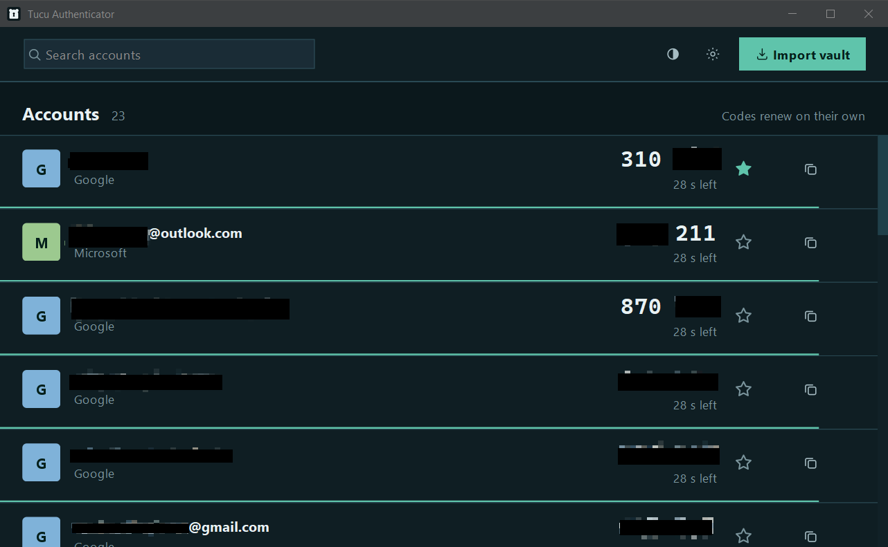

# Tucu Authenticator

Desktop 2FA authenticator (Java 25 + Swing + FlatLaf). Companion to the [Aegis](https://getaegis.app) Android app — imports its vault exports, **encrypted or plaintext**, and shows live TOTP codes.

<p align="center"></p>

## Design system — "Quietud de ribera"

- FlatLaf token themes: `src/main/resources/org/umilab/tucu/auth/ui/FlatDarkLaf.properties` and `FlatLightLaf.properties` (from the designer's branding package).
- Dark mode is the default; toggle anytime with the theme icon in the toolbar. The choice is persisted (Java Preferences).
- Account rows show the code grouped `824 193`, the seconds left, a copy icon with in-row "Copied" confirmation, and a 2 px tide line that drains calmly — no flashing, no pure red, no alarm colors.
- Each row has a star toggle: favorited accounts stay pinned to the top of the list. The flag is stored inside the encrypted vault and survives restarts.
- Icons and the Tucu mark are SVGs rendered via FlatSVGIcon — crisp at any DPI.
- Window + installer icons: `src/main/resources/logo/`.

## Languages

English is the default. Spanish is selected automatically when the OS locale is Spanish. Bundles live in `src/main/resources/i18n/` (`messages.properties` = English fallback, `messages_es.properties` = Español) so translators can edit them without touching code.

## Security model

- Vault: `%APPDATA%\TucuAuthenticator\vault.tucu` (Windows), `~/.config/TucuAuthenticator/vault.tucu` (Linux), `~/Library/Application Support/TucuAuthenticator/vault.tucu` (macOS)
- Format: JSON envelope — `version`, `header.slots` (wrapped key + KDF params), `header.params` (nonce + GCM tag), `db` (ciphertext)
- Crypto (local vault is pure JDK crypto; Bouncy Castle is used only for the scrypt KDF when importing Aegis's encrypted exports):
  - **KDF:** PBKDF2WithHmacSHA256, 600,000 iterations, 32-byte salt
  - **Cipher:** AES-256-GCM, 256-bit keys, 96-bit random nonce, 128-bit tag, header fields bound as AAD
  - **Envelope:** random 256-bit DEK encrypts the DB; password-derived KEK wraps the DEK, so a password change only re-wraps one key
- The password is never stored. Wrong password = GCM tag failure. There is no recovery: if you forget it, delete `vault.tucu` and start over.
- Auto-lock after a configurable timeout (default 10 min, hard cap regardless of activity): data is hidden behind a lock screen until re-authentication.
- Clipboard is auto-cleared ~30 s after copying a code (only if the clipboard still holds that code).
- Passwords, keys and TOTP secrets live in `char[]`/`byte[]` and are wiped on lock/exit. Nothing secret is ever logged.

## Importing from Aegis

Both Aegis export modes are supported:

- **Encrypted export (recommended):** in Aegis, export the vault with a password. Tucu asks for that password once during import (it is never stored), unwraps the slot's master key with scrypt, and decrypts the vault — the same chain Aegis itself uses (`scrypt` N=32768/r=8/p=1 → AES-256-GCM, hex slots, base64 db). Biometric-only exports cannot be unlocked on a computer — protect the export with a password instead.
- **Plaintext export:** works too, but it contains your secrets in cleartext — the app warns you before importing and reminds you to delete the file afterwards.

Re-importing replaces entries that match by UUID. Favorites (`favorite` flag) are imported from Aegis; an account already favorited in Tucu keeps its star across re-imports.

## Run in development mode

```bash
mvn compile exec:java -Dexec.mainClass=org.umilab.tucu.auth.App
```

or run `org.umilab.tucu.auth.App` from your IDE. First launch asks you to create a master password; then use **Import vault** to load an Aegis export (encrypted exports prompt for their password).

## Tests

```bash
mvn test
```

Covers vault encrypt/decrypt round-trip, wrong-password and tamper detection, password re-wrap, RFC 6238 TOTP vectors, the Aegis importer (including a real encrypted-export fixture decrypted end-to-end with scrypt + AES-GCM), and favorite-flag persistence.

## Build a distributable package (jpackage)

Produce the fat jar:

```bash
mvn package
```

then stage just the jar into a clean input folder and run jpackage (comes with the JDK):

```cmd
mkdir dist
copy target\tucu-authenticator-1.0.0.jar dist\
```

On Windows you have two options:

### Option A — portable folder (recommended, simplest to copy)

```cmd
jpackage ^
  --type app-image ^
  --name "TucuAuthenticator" ^
  --input dist ^
  --main-jar tucu-authenticator-1.0.0.jar ^
  --main-class org.umilab.tucu.auth.App ^
  --app-version 1.0.0 ^
  --vendor "Tucu" ^
  --icon src\main\resources\logo\tucu.ico
```

This creates a `TucuAuthenticator\` folder **in the directory where you ran the command** (or in the folder given with `--dest <dir>`). Inside it is `TucuAuthenticator.exe` plus the bundled Java runtime — everything self-contained.

To move the app to another computer: **copy the whole `TucuAuthenticator\` folder** (e.g. to a USB drive) and run `TucuAuthenticator.exe` inside it. No Java installation is needed on the target machine.

### Option B — Windows installer (.exe)

```cmd
jpackage ^
  --type exe ^
  --name "TucuAuthenticator" ^
  --input dist ^
  --main-jar tucu-authenticator-1.0.0.jar ^
  --main-class org.umilab.tucu.auth.App ^
  --app-version 1.0.0 ^
  --vendor "Tucu" ^
  --icon src\main\resources\logo\tucu.ico ^
  --win-dir-chooser --win-shortcut --win-menu
```

This creates `TucuAuthenticator-1.0.0.exe` **in the directory where you ran the command** (or `--dest <dir>`). Copy that single file to another computer and run it to install — it offers a Start Menu shortcut and optional desktop shortcut. Building the `.exe` requires [WiX Toolset](https://wixtoolset.org) 3.x installed; Option A needs nothing extra.

(On macOS use `--type dmg`, on Linux `--type deb`.)

## License

**GNU General Public License v3.0** — see `LICENSE`. Free to use, modify, and share under the terms of the GPL, matching the license of [Aegis Authenticator](https://github.com/beemdevelopment/Aegis), which this app is a companion to.

## Notes / residual risks

- A pure-Java app cannot prevent the OS from paging memory to disk or stop other apps from reading the clipboard. Memory wiping and the clipboard auto-clear mitigate but do not eliminate this.
- Only TOTP + SHA1 + 6-digit entries are imported; anything else in the export (HOTP, Steam, SHA-256/512, 8-digit) is skipped and reported.
- Deleting `vault.tucu` is the documented "forgot password" escape hatch.

## Why "Tucu"?

The *tuco-tuco* is a small South American rodent that biologists half-jokingly call a **bioengineer**: it spends its entire life underground, digging tunnels, moving soil, and quietly reshaping the landscape — the ecosystem's own in-house developer, always building, never shipping a changelog. It felt like the right mascot for this app: a little builder that keeps everything safe in its burrow and never lets a secret leave the tunnels.

---

<sub>Made with love — and a lot of help from <a href="https://devin.ai">Devin</a>, the hardest-working otter in software.</sub>

<p align="left"><a href="https://devin.ai"></a></p>
